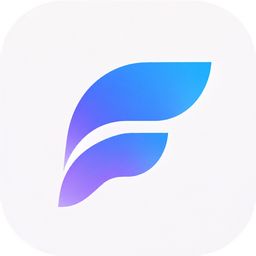

<div align="center">



# NovaForge

**Dependable, Local-First AI Software Built for Real Companies**

[](#repository-structure)
[](#running-locally)
[](mailto:info.novaforge.2026@gmail.com)

</div>

---

## About NovaForge

**NovaForge** builds private, local-first AI software designed to run directly on a company's own Mac, Windows workstation, or office LAN server — with **zero external runtime dependencies** and **zero third-party cloud lock-in**.

Your organization retains complete custody of every spreadsheet, GST invoice, driver payroll sheet, and customer record while connecting your own AI provider key (or running 100% offline AI models).

This repository hosts the official **NovaForge** company website showcasing our philosophy, flagship products, editions & pricing, deployment walkthrough, founders, and direct inquiry flow.

---

## Flagship Products

### 1. Float AI Agent
**Best for:** General business teams, managers, and analysts who want a private AI workspace and spreadsheet studio on their own computers.

- **Float Sheets Studio:** Built-in `1,000 × 1,000` spreadsheet grid with Excel (`.xlsx`) import/export, PDF reports, live charts, and formula evaluation.
- **Bring Your Own AI Key:** Connect OpenAI, Anthropic, Google Gemini, OpenRouter, or offline local models with zero middleman markups.
- **Advanced Data Encryption:** AES-256-GCM sealed key transport and device-bound local key storage.
- **Team Governance:** Role-based employee permissions (RBAC), per-member monthly AI spend caps, safe file library, and automated daily backups.
- **Pricing:** Float Editions start at **₹6 Lakh (One-Time)**.

### 2. Float for Finance
**Best for:** Car rental agencies, multi-branch fleet operators, and finance teams requiring strict GST billing, driver payroll, and owner approvals.

- **Locked GST Billing:** Sequential GST invoices and credit notes that cannot be silently altered (immutable database-level triggers).
- **Accurate GST Math & Driver Payroll:** Exact `Decimal` `ROUND_HALF_UP` tax calculations with complete PF, ESI, PT, and TDS payroll reconciliation.
- **3-Tier Owner Approval Checkpoints:** Staff prepare drafts while owners sign off on salary runs, bank updates, and payouts.
- **Privacy & Compliance:** India DPDP Act 2023 consent tracking, automatic GPS/EXIF photo location removal, and 30/60/90-day expiry alerts for insurance, PUC, permits, and licences.
- **Pricing:** Contact us for tailored licensing and full buyout options.

---

## Float Editions & Pricing

Every Float edition is a **one-time company purchase** with **unlimited staff and shift-worker logins** — no recurring per-seat monthly fees. Companies can upgrade later by paying only the difference.

| Edition | One-Time Price | Vehicle Capacity | Branches | Key Highlights |
| :--- | :---: | :---: | :---: | :--- |
| **1. Float Basic** | **₹6 Lakh** | Up to 25 cars | 1 branch | Unlimited staff, Express Clean-to-Ready wash queue, instant GST quotes & agreements, Counter PIN lock, English & Hindi |
| **2. Float Plus** | **₹9 Lakh** | Up to 60 cars | 1 branch | Everything in Basic + 1-click wave batch dispatch, 1-click mid-trip extensions, FASTag/e-challan auto-matcher, 360° checklists, all 13 Indian languages, Google Drive backup |
| **3. Float Pro (Recommended)** | **₹13.5 Lakh** | Up to 150 cars | 1 branch | Everything in Plus + **Tough-grade privacy & high-level cyber-attack security**, all 19 AI workflows, locked GST invoices & credit notes, corporate B2B accounts, workshop job cards, RevPAC yield analytics |
| **4. Float Enterprise** | **₹16.5 Lakh** | Up to 500 cars | Up to 5 branches | Everything in Pro + **Tough-grade privacy & high-level cyber-attack security**, multi-PC office LAN server, 5 employee permission roles (RBAC), cash drawer reconciliation, driver roster, India DPDP Act 2023 compliance, bulk Excel/CSV importer |
| **5. Float Enterprise Max** | **₹21 Lakh** | **Unlimited** | **Unlimited** | Everything in Enterprise + **Maximum cyber-attack security**, inter-branch vehicle transfers, complete before/after JSON field-level audit trail, MCP integrations (GPS/CRM/ERP), operator-confirmed desktop automation, 100% offline local AI (Ollama) |

### Included With Every Edition
- **Guided Installation:** Live setup support on macOS and Windows (15–30 minutes for a single counter PC; 1–2 hours for a multi-computer office LAN).
- **Hands-On Onboarding:** Live training for managers and counter staff, GST rate-card setup, and spreadsheet migration assistance.
- **Direct Founder Support:** Email and scheduled screen-share technical support directly from the engineers who built Float.
- **Future Updates:** **12 months of free software updates** included (security patches, GST compliance updates, refinements). Renewals after year one are optional — your licensed software keeps working permanently.

---

## Website Highlights

- **Zero Build Tools or External Frameworks:** Built with clean, self-contained HTML, CSS, and vanilla JavaScript for instant loading and effortless hosting.
- **Security Hardened:** Includes strict `Content-Security-Policy` and `Referrer-Policy` headers in [`index.html`](index.html).
- **Editorial Typography & Palette:** Warm archival palette with Times New Roman headings and Calibri body copy, completely free of italics and visual clutter.
- **Interactive Experience:**
  - Persistent sticky navigation with live active-section highlighting and mobile quick-access menu.
  - macOS terminal showcase with dual product demos (`Float AI Agent` & `Float for Finance`).
  - Interactive capability switchers with spring-gliding tabs and 3D hover lighting on product cards.
  - Connected 3-step deployment walkthrough with high-resolution Float UI screenshots.
  - Side-by-side 5-edition comparison table, expandable FAQ accordion, and email/copy inquiry builder.
  - Full `prefers-reduced-motion` accessibility support.

---

## Repository Structure

```text
NovaForge/
├── index.html                 # Main single-page website markup & CSP headers
├── styles.css                 # Layout, typography, responsive rules & animations
├── script.js                  # Scroll-spy nav, terminal showcase, switchers, workflow & inquiry form
├── favicon.ico                # Multi-resolution browser favicon (16px–256px)
├── assets/
│   ├── float-logo.png         # Float squircle logo (256×256)
│   ├── step-1-launch.png      # Workflow screenshot: Local workspace & wash queue
│   ├── step-2-apikey.png      # Workflow screenshot: Encrypted API keys & spend caps
│   └── step-3-approvals.png   # Workflow screenshot: Owner approvals & locked GST invoices
└── README.md                  # Repository documentation
```

---

## Running Locally

Because the site uses zero build tools or external dependencies, you can preview it immediately with any static HTTP server:

```bash
# Using Python 3
python3 -m http.server 8000

# Or using Node.js
npx serve .
```

Then open `http://localhost:8000` in your browser.

### Deployment
Push to `main` and enable **GitHub Pages** (`Settings → Pages → Deploy from a branch → main / (root)`), or deploy directly to Netlify / Cloudflare Pages with no build command required.

---

## Founders

NovaForge is founded, engineered, and directly supported by three builders:

- **Prabhjot** — Co-Founder & Chief Executive Officer (CEO)
- **Shiva** — Co-Founder & Lead Developer
- **Yatharth** — Co-Founder & Head of Product & Design

---

## Contact & Inquiries

For licensing, live demonstrations, pilot deployments, or custom buyout discussions, contact the founders directly:

- **Email:** [info.novaforge.2026@gmail.com](mailto:info.novaforge.2026@gmail.com)